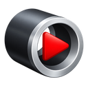
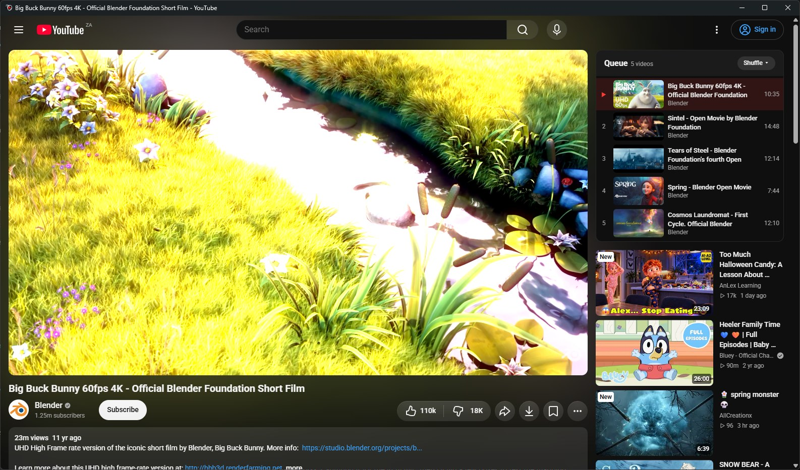
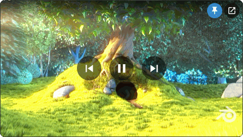
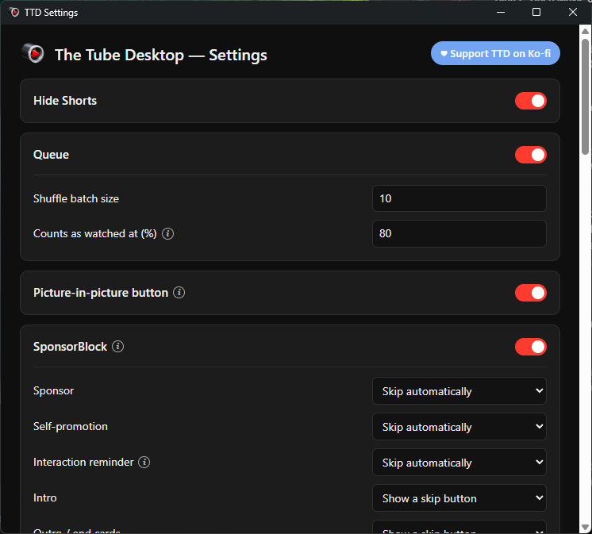
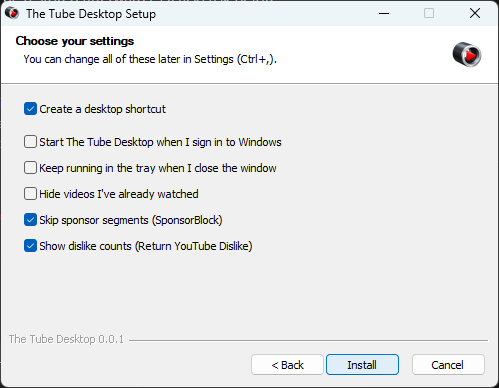

<p align="center"></p>

<h1 align="center">The Tube Desktop</h1>

<p align="center">YouTube as a proper Windows app, with the controls I always wanted the website to have.</p>

<p align="center">
  <a href="https://github.com/CodeManMike/the-tube-desktop/releases/latest"><b>Download for Windows</b></a>
  ·
  <a href="https://ko-fi.com/J4O422SFGR">Support it on Ko-fi</a>
</p>

<p align="center"></p>

The Tube Desktop (TTD) is the real desktop YouTube in its own window. Your account, your subscriptions and YouTube Premium all work as normal, and so do Movies, 4K and HDR. On top of that I added the things I kept wishing for: a queue that stays put while you browse, a picture-in-picture window that floats over everything, sponsor and ad skipping, dislike counts, and a tray icon with global hotkeys.

I built it for myself first. It's Windows only, and it's free.

## Features

- **A queue that belongs to the app.** Add videos from anywhere, wander off to browse, and the queue carries on where you left it. Shuffle plays in batches and skips what you've already watched.
- **Picture-in-picture.** A small frameless window that stays on top, keeps your place, and hands the video back to the main window when you close it. Mute and volume come with it. `Ctrl+Shift+P` or the button in the player.
- **SponsorBlock.** Skips sponsor segments, intros and the other categories you pick, using the SponsorBlock community's data.
- **Ad skip.** For when YouTube Premium isn't already removing ads. TTD strips them out before the player sees them, and skips any that still get through (or shows you a skip button, if you'd rather choose).
- **Dislike counts**, estimated by Return YouTube Dislike.
- **Hide Shorts, hide watched videos, block channels.** Blocking is one click from a video's ⋮ menu.
- **Pinned quality.** Every video starts at the quality you choose, not whatever YouTube guesses.
- **Low power mode.** Forces H.264 to save CPU on laptops (caps at 1080p without HDR).
- **Themes.** YouTube's own, pure black for OLED screens, dim, or your own CSS.
- **Tray icon and global hotkeys.** Play/pause, next, previous and picture-in-picture work even when TTD isn't focused. Close the window and it keeps playing in the tray, if you want it to.
- **Start with Windows**, if you want that too.
- **Sign-out warning.** If YouTube signs you out, TTD tells you instead of quietly showing you a signed-out home page.
- **Voice search** works, using YouTube's own microphone button.

Everything is a plugin you can switch off in Settings (`Ctrl+,`). If a plugin ever breaks on a page, TTD turns it off for that page and YouTube carries on as normal.

<p align="center">
  
  
</p>

## Install

1. Download `TheTubeDesktop-Setup-<version>.exe` from the [latest release](https://github.com/CodeManMike/the-tube-desktop/releases/latest).
2. Run it. The installer lets you choose where it goes, whether to add a desktop shortcut, and which settings to start with.
3. Sign in to YouTube inside the app the way you normally would.

<p align="center"></p>

The installer isn't signed with a code-signing certificate yet, so Windows SmartScreen may warn you the first time. Click **More info**, then **Run anyway**.

Your settings, queue and sign-in live in `%APPDATA%\The Tube Desktop`. Uninstalling keeps them, so reinstalling picks up where you left off.

## Hotkeys

| Action | Default |
| --- | --- |
| Play/pause | `Ctrl+Alt+Space` |
| Next in queue | `Ctrl+Alt+Right` |
| Previous in queue | `Ctrl+Alt+Left` |
| Picture-in-picture | `Ctrl+Alt+P` |
| Settings | `Ctrl+,` |

You can change the global ones in Settings. If another app already owns a combination, TTD skips it rather than fighting over it.

## Privacy

TTD talks to YouTube the same way the website does. Two plugins talk to other services, and both are on by default:

- **SponsorBlock** sends a short hash of the video ID, never the ID itself.
- **Show dislikes** sends the video ID to Return YouTube Dislike.

Switch either off in Settings and nothing goes to them. TTD has no analytics and no account of its own.

## Support

TTD is free and I'm a solo developer. If it makes your YouTube better and you'd like to say thanks, a coffee helps me keep working on it.

<a href="https://ko-fi.com/J4O422SFGR"></a>

There's also a Ko-fi link in the Settings window and the tray menu.

Bugs and ideas are welcome as [GitHub issues](https://github.com/CodeManMike/the-tube-desktop/issues).

## Building from source

You need Windows 10 or 11, Node.js 24+ and Python 3.

```bash
npm install
npm start
```

`npm install` also runs castLabs' installer. Run the tests with `npm test`.

### DRM signing

TTD is built on [castLabs Electron](https://github.com/castlabs/electron-releases), which adds Widevine. Protected content like Movies needs a build signed through castLabs' free EVS service with your **own** account:

```bash
python -m pip install --upgrade castlabs-evs
python -m castlabs_evs.account signup
npm run sign
```

`npm run dist` builds the installer and signs the packaged app as part of the build (the upload takes a minute or two). If the build stops with `EBUSY` on an `.asar` file, another Electron app is holding the output folder open; close it, or build to a different folder with `npx electron-builder --win -c.directories.output=<folder>`.

## License

[PolyForm Noncommercial 1.0.0](LICENSE.md). You can use, study and change TTD for anything non-commercial. Selling it, or building it into a commercial product, needs my written permission first.

The icons are part of this project and covered by the same license. castLabs Electron and the other dependencies have their own licenses.

## Disclaimer

The Tube Desktop is an independent project. It is not affiliated with, endorsed by or sponsored by YouTube or Google. YouTube is a trademark of Google LLC.
